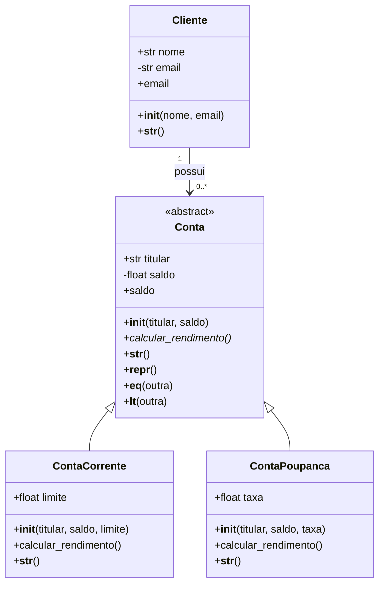

# Sistema Bancário em Python — Programação Orientada a Objetos

## Descrição do Projeto

Este projeto apresenta um sistema bancário desenvolvido em Python com o objetivo de aplicar os principais conceitos de Programação Orientada a Objetos (POO).

O sistema utiliza classes, herança, encapsulamento, polimorfismo, métodos especiais e tratamento de exceções para representar clientes e diferentes tipos de contas bancárias.

## Tecnologias Utilizadas

- **Python:** linguagem utilizada no desenvolvimento.
- **ABC:** criação de classes abstratas.
- **@abstractmethod:** definição de métodos obrigatórios nas classes filhas.
- **@property:** encapsulamento e validação de atributos.
- **Regex (`re`):** validação do formato de e-mail.
- **Try/Except:** tratamento de exceções.

## Diagrama de Classes

O diagrama abaixo representa a estrutura proposta para o sistema bancário.



A classe `Conta` é abstrata e serve como base para `ContaCorrente` e `ContaPoupanca`. A classe `Cliente` representa os dados do titular.

## Decisões de Modelagem

### Herança

A herança foi utilizada porque contas correntes e contas poupança compartilham características, como titular e saldo.

A classe `Conta` concentra esses atributos e os comportamentos comuns, evitando repetição de código.

As classes filhas utilizam `super().__init__()` para reaproveitar o construtor da classe mãe.

### Composição e Associação

O relacionamento entre `Cliente` e `Conta` representa a possibilidade de um cliente possuir diferentes contas bancárias.

Essa separação permite organizar as responsabilidades de cada classe, mantendo os dados pessoais separados das operações bancárias.

O relacionamento é apresentado como associação no diagrama e pode ser implementado por meio de referências entre objetos.

### Classe Abstrata

A classe `Conta` utiliza `ABC` e `@abstractmethod` para definir o método obrigatório `calcular_rendimento()`.

Cada tipo de conta implementa esse método de acordo com suas próprias regras.

### Polimorfismo

O polimorfismo permite utilizar o mesmo método em objetos diferentes.

No sistema, `calcular_rendimento()` apresenta comportamentos distintos:

- **ContaCorrente:** rendimento demonstrativo de 1% do saldo.
- **ContaPoupanca:** rendimento demonstrativo de 5% do saldo.

As taxas são utilizadas apenas para demonstrar o funcionamento do polimorfismo, não representando regras bancárias reais.

## Encapsulamento e Validações com @property

O encapsulamento foi utilizado para controlar o acesso e a alteração de atributos.

### Validação do Saldo

O atributo `saldo` utiliza `@property` e `@saldo.setter` para impedir valores negativos.

```python
@property
def saldo(self):
    return self._saldo

@saldo.setter
def saldo(self, valor):
    if valor < 0:
        raise ValueError("O saldo não pode ser negativo!")
    self._saldo = valor
```

Essa validação evita que o saldo receba valores incompatíveis com as regras definidas para o projeto.

### Validação do E-mail

O e-mail do cliente é validado utilizando expressões regulares.

```python
@property
def email(self):
    return self._email

@email.setter
def email(self, valor):
    padrao = r"^[\w.+-]+@[\w.-]+\.[a-zA-Z]{2,}$"

    if not re.fullmatch(padrao, valor):
        raise ValueError("E-mail inválido!")

    self._email = valor
```

A validação verifica o formato básico do e-mail, incluindo a presença de `@` e domínio.

Ela não confirma se o endereço realmente existe.

## Métodos Especiais

Foram considerados os seguintes métodos especiais:

| Método | Finalidade |
|---|---|
| `__init__` | Inicializar os atributos dos objetos. |
| `__str__` | Exibir informações de maneira amigável. |
| `__repr__` | Representar o objeto de forma técnica. |
| `__eq__` | Comparar objetos utilizando `==`. |
| `__lt__` | Comparar objetos utilizando `<`. |

Esses métodos permitem uma integração mais natural dos objetos com os recursos da linguagem Python.

## Exemplos de Uso

### Criação de Contas

```python
corrente = ContaCorrente("João", 1500, 500)
poupanca = ContaPoupanca("Maria", 2000, 0.05)

print(corrente)
print(poupanca)
```

### Demonstração de Polimorfismo

```python
contas = [
    ContaCorrente("João", 1000, 500),
    ContaPoupanca("Maria", 2000, 0.05)
]

for conta in contas:
    print(f"Rendimento: R$ {conta.calcular_rendimento():.2f}")
```

Exemplo de resultado:

```text
Rendimento: R$ 10.00
Rendimento: R$ 100.00
```

### Tratamento de Exceções

```python
try:
    conta = ContaCorrente("Pedro", -500, 200)

except ValueError as erro:
    print(f"Erro: {erro}")
```

Saída esperada:

```text
Erro: O saldo não pode ser negativo!
```

## Testes e Demonstração

O projeto prevê a criação de pelo menos 10 instâncias, distribuídas entre contas correntes e contas poupança.

Os testes contemplam:

- Criação de objetos de diferentes classes.
- Utilização de herança e `super()`.
- Demonstração do polimorfismo.
- Validação de saldo e e-mail.
- Comparação e representação de objetos.
- Tratamento de entradas inválidas com `try/except`.

## Conclusão

O projeto demonstra a aplicação dos fundamentos de Programação Orientada a Objetos em Python, utilizando um sistema bancário como exemplo prático.

A estrutura baseada em classes permite organizar responsabilidades, reaproveitar código por meio de herança e aplicar diferentes comportamentos utilizando polimorfismo.

O encapsulamento com `@property`, os métodos especiais e o tratamento de exceções contribuem para tornar o sistema mais organizado, consistente e de fácil manutenção.
